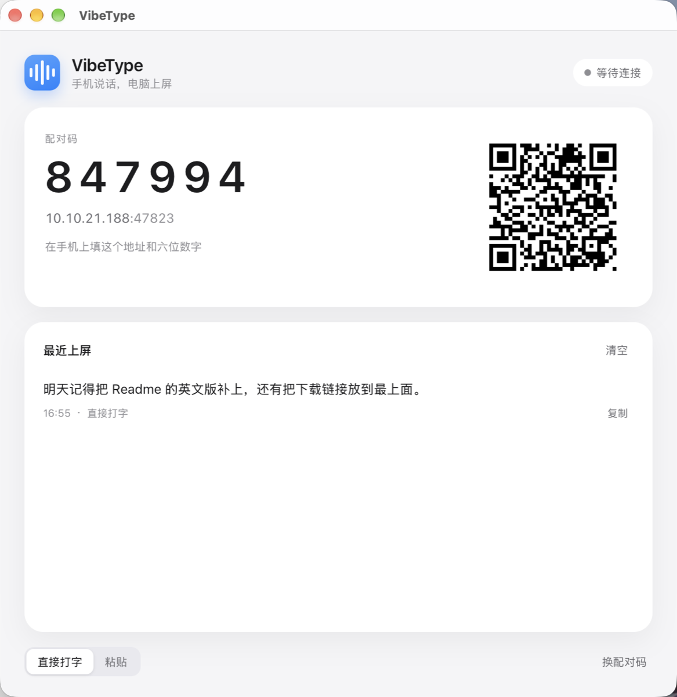
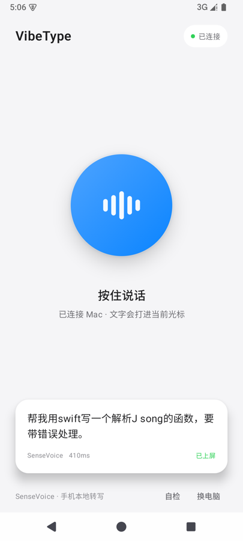

# VibeType

**Speak on your phone; the text appears on your computer.**

Speech is transcribed on the phone itself; only a few dozen bytes of text cross the network.
The Mac and Windows apps do no recognition, install no virtual audio device, and do not depend
on an IME — they type the text into whatever has focus.

```
Android (X-ASR streaming, on-device)
        │  text over LAN TCP
        ├── macOS
        └── Windows
```

<p align="center">
  
  
</p>

## Why this route

The previous generation, VibeDeck, treated the phone as a microphone and ran recognition on the
computer: audio over the network, a virtual audio device, an auto-pressed voice key, and an IME
that had to cooperate. It worked on macOS, but on Windows it meant another driver and another
IME, and recognition quality was tied to a third party.

Moving ASR onto the phone changes that:

- **Audio never leaves the phone** — only text goes over the network.
- **No audio driver on the desktop** — no BlackHole / VB-Cable.
- **No IME dependency** — text is injected straight into the focused field.
- **One desktop codebase for both OSes** — Tauri 2, installer around 10 MB.

## Layout

```
vibetype/
├── android/           Android (Kotlin + Compose + sherpa-onnx)
├── desktop/           Desktop (Tauri 2: Rust core + React UI)
├── docs/
│   ├── architecture.md
│   ├── protocol.md
│   └── en/            English translations
└── .github/workflows/ macOS / Windows installers
```

## Status

v0.1 in development: hold to talk → local transcription → type on the desktop.

- [x] Project skeleton and protocol
- [x] Android: recording, X-ASR streaming + hotwords + term correction, pairing, sending
- [x] macOS / Windows: pairing, receiving, injection
- [x] End-to-end: on-device transcription → text typed into TextEdit on a Mac
- [x] Emulator: 4.8 s of audio transcribed in 410–650 ms (RTF ≈ 0.09–0.13)
- [x] macOS installer (local and CI)
- [x] Windows installer (CI: NSIS + MSI)
- [x] Model bundled in the APK (X-ASR 162 MB, APK ~217 MB, no download after install)
- [x] Trackpad and five keys: pointer, scroll, right click, pinch zoom, hold-and-drag; pointer speed and natural scrolling settings
- [x] Keymap edited on the desktop: the phone sends actions, mapped to a key or to launching/focusing an app such as Codex or WorkBuddy
- [x] Thought capsules: hold to record, on-device transcription, kept on the phone, copied to the desktop
- [x] Desktop console (Overview / Connect / Devices / Capsules / MCP / Settings)
- [x] MCP: `vibetype --mcp` exposes a stdio server around capsules — list unprocessed → digest → mark processed — with a Skill, Prompt and Resource
- [x] Real device (K80) self-test: 4.8 s transcribed in 116 ms, RTF 0.02; live typing and capsule sync verified
- [ ] English term recognition (JSON heard as “J song”)
- [x] First-run onboarding, gesture playground, trackpad speed and edge-scroll settings
- [x] Chinese/English UI on both phone and desktop, plus dark mode (follow system or manual)
- [x] Automatic desktop discovery after an office/Wi-Fi change (UDP broadcast); manual address entry without re-pairing
- [x] In-app QR pairing: the rear camera reads the desktop QR and fills in the address and code

## Using it with an agent

A capsule is not a todo; it is a **thought inbox**. One press and one sentence on the phone, synced
to the computer when connected. The agent on the desktop does the digesting, over MCP:

```bash
# Claude Code as an example; see the app's MCP page for other clients
claude mcp add --transport stdio vibetype -- "/Applications/VibeType.app/Contents/MacOS/vibetype" --mcp
```

The full agent guide lives in [`skills/vibetype-capsules/SKILL.md`](skills/vibetype-capsules/SKILL.md):
what capsules are, why they work this way, the standard flow and the boundaries. Three delivery paths:

- the MCP handshake carries `instructions`, so it works without configuration;
- `prompts/list` includes `organize_capsules` for a one-line trigger;
- `resources/read` of `vibetype://skill` returns the same full text; the app can also install it into
  `~/.claude/skills`, `~/.agents/skills`, `~/.config/opencode/skills`, or `~/.codex/skills`.

Recommended loop: `capsules_list` (unprocessed only) → the agent digests and asks → the user confirms →
`capsules_mark` marks them used → `text_type` puts the result back at the cursor when needed.

## Development

### Android

```bash
cd android
# sdk.dir in local.properties, or set ANDROID_HOME
JAVA_HOME=/opt/homebrew/opt/openjdk@21/libexec/openjdk.jdk/Contents/Home \
ANDROID_HOME=/opt/homebrew/share/android-commandlinetools \
./gradlew assembleRelease
```

The model is bundled in the APK; fetch it once before building (about 134 MB compressed, cached in
`.cache/`, not in git):

```bash
tools/fetch_model.sh
```

The release APK is about **217 MB**. Signing uses the repository's
`android/app/vibetype-release.jks` (password `vibetype2026`) — the same key locally and in CI, so
`adb install -r` upgrades in place. This is a sideloading key, not a Google Play release key.

Debug builds have a “Self-test” button at the bottom of the home screen: it runs a bundled 16 kHz
clip through the full transcription and send path, so the chain can be verified without a phone
microphone.

### Desktop

```bash
cd desktop
npm install
npm run tauri dev        # development
npm run tauri build      # local installer
```

On first launch, macOS asks for Accessibility permission; it also asks whether VibeType may accept
incoming connections — choose Allow, or the phone cannot connect. On Windows, if the target app runs
as administrator, VibeType must run with the same elevation.

You can test the chain without a phone:

```bash
python3 tools/fake_phone.py 127.0.0.1 47823 <pairing-code> "hello"
```

### Windows

You do not need a Windows machine to build: `.github/workflows/desktop.yml` builds the NSIS installer
on `windows-latest` and uploads it as an artifact alongside macOS.

## License

Code is MIT. The default X-ASR model is Apache-2.0; the optional SenseVoice weights follow the FunASR
Model License v1.1 (commercial use allowed with attribution). See [docs/en/architecture.md](docs/en/architecture.md).

---

[中文 README](README.md)
