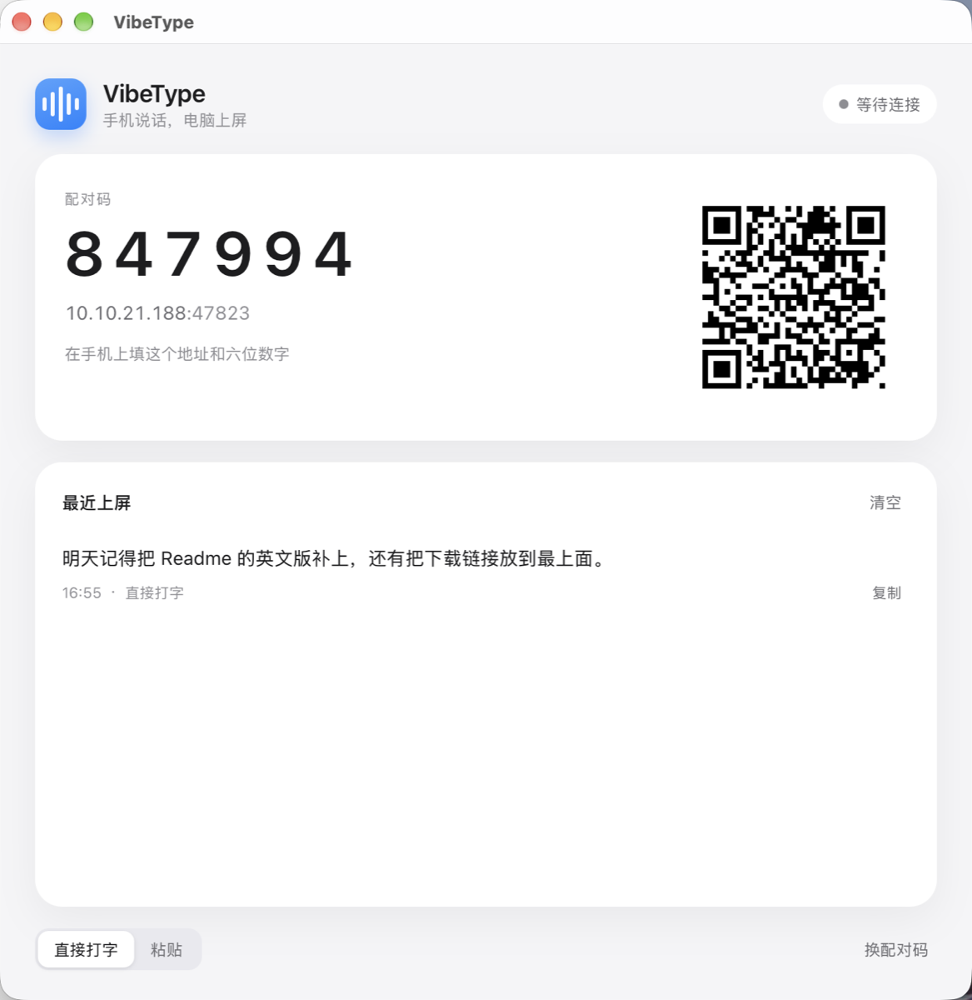
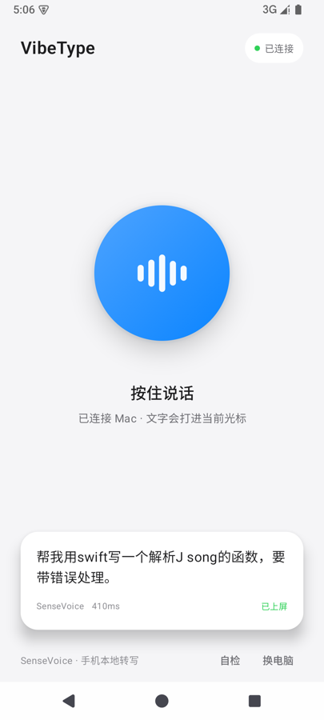

# VibeType

**手机说话，电脑上就出字。**

语音在手机本地转写成文字，只把几十字节的结果发到电脑；Mac 与 Windows 端不做识别、不装虚拟声卡、不依赖输入法，收到文字后直接打进当前焦点。

```
Android（SenseVoice，本地转写）
        │  文字，局域网 TCP
        ├── macOS
        └── Windows
```

<p align="center">
  
  
</p>

## 为什么是这条路

上一代 VibeDeck 的做法是「手机当麦克风，电脑上的豆包负责写字」：音频要过网、要虚拟声卡、要自动按语音键、要输入法配合。这条链路在 macOS 上能跑，但换到 Windows 就要重装一套驱动和输入法，且识别质量被第三方输入法绑死。

把 ASR 放回手机之后：

- **音频不出手机**——过网的只有文字，隐私和带宽都不是问题；
- **电脑端不需要声卡驱动**——不用 BlackHole / VB-Cable；
- **不依赖任何输入法**——文字直接注入焦点输入框；
- **一套桌面代码两端用**——Tauri 2，安装包约 10 MB。

## 目录

```
vibetype/
├── android/           Android 端（Kotlin + Compose + sherpa-onnx）
├── desktop/           桌面端（Tauri 2：Rust 内核 + React 界面）
├── docs/
│   ├── architecture.md
│   └── protocol.md
└── .github/workflows/ macOS / Windows 安装包构建
```

## 状态

v0.1 正在开发：按住说话 → 本地转写 → 电脑上屏。

- [x] 项目骨架与协议
- [x] Android：录音、SenseVoice、配对、发送
- [x] macOS / Windows：配对、接收、注入
- [x] 端到端实测：手机本地转写 → 文字打进 Mac 的 TextEdit
- [x] 模拟器实测：4.8 秒录音转写 410–650 ms（RTF ≈ 0.09–0.13）
- [x] macOS 安装包（本地与 CI）
- [x] Windows 安装包（CI：NSIS + MSI）
- [x] 模型随 APK 打包（APK 约 284 MB，安装后无需下载）
- [ ] 真机（K80）RTF 与识别质量
- [ ] 英文术语识别（JSON 被听成 “J song”）
- [ ] 胶囊（v0.2）、触控板（v0.3）

## 开发

### Android

```bash
cd android
# local.properties 里写 sdk.dir，或设 ANDROID_HOME
JAVA_HOME=/opt/homebrew/opt/openjdk@21/libexec/openjdk.jdk/Contents/Home \
ANDROID_HOME=/opt/homebrew/share/android-commandlinetools \
./gradlew assembleDebug
```

模型随 APK 打包，构建前先拉一次（228 MB，缓存在 `.cache/`，不进 git）：

```bash
tools/fetch_model.sh
```

产物 `app/build/outputs/apk/debug/app-debug.apk` 约 **284 MB**。debug 包首页底部有
「自检」按钮：把内置的一段 16 kHz 录音跑一遍完整的转写 + 发送，用来在没有真机
麦克风时验链路。

### 桌面端

```bash
cd desktop
npm install
npm run tauri dev        # 开发
npm run tauri build      # 本机安装包
```

macOS 首次启动会请求「辅助功能」权限；系统还会问是否允许 VibeType 接受传入连接，
要点「允许」，否则手机连不上。Windows 对管理员权限运行的目标程序需要同权限运行 VibeType。

没有手机也能测通链路：

```bash
python3 tools/fake_phone.py 127.0.0.1 47823 <配对码> "测试文字"
```

### Windows

本机不装 Windows 也能出包：`.github/workflows/desktop.yml` 在 `windows-latest` 上构建 NSIS 安装包，和 macOS 一起作为 artifact 上传。

## 许可

代码 MIT。SenseVoice 模型权重遵循 FunASR Model License v1.1（允许商用，需保留署名），详见 [docs/architecture.md](docs/architecture.md)。
